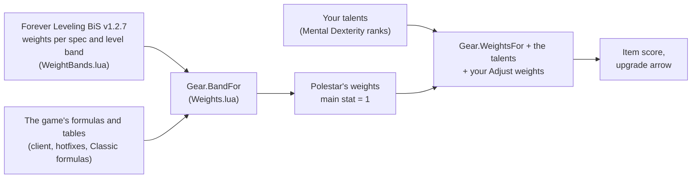

# Gear advice: the stat weights

Stat weights from Forever Leveling BiS by Thunder, used with the author's
permission (2026-11-13).

Gear advice scores an item by adding up its stats, each times a weight: how
many points of the spec's main stat one point (or 1%) of that stat is worth to
a character of that spec at that level. This page says where every weight comes
from, how Polestar reads it, and which game formulas explain it.

## Where the numbers come from

- **Forever Leveling BiS v1.2.7** (its `Data/ModelWeights.lua`, made on
  2026-11-11) gives every class and spec twelve level bands: 1-9, 10-14,
  15-19, and so on in steps of five to 55-59, then 60. Its numbers are in
  its own units: the spec's anchor stat is 1 (attack power, ranged attack
  power for a Hunter, spell damage, or healing for a healer).
  `addon/Polestar/Gear/WeightBands.lua` holds them as the addon ships them,
  in its own stat names; a band's missing stat is a 0.
- **Polestar's own** are the stats those numbers leave out (health, mana,
  health per 5 seconds, armor penetration), made from the game's formulas
  below, and the share of Intellect Mental Dexterity turns into attack power.
  The tables at the end mark them with `*`; `Gear.GetWeightsInfo().ours` lists
  them for the band in use.

Polestar's specs are the three talent columns of each class. Forever Leveling
BiS also has weights for melee Survival Hunters, a Bear set for Druids and a
one-hander-and-shield set for Enhancement Shamans; Polestar uses ranged
Survival, Feral's Cat weights and the two-hander set.

## How Polestar reads a band

`Gear.BandFor(class, spec, level)` (Weights.lua) takes the band whose top level
reaches `level` (the last band past it) and:

1. **Names the stats Polestar's way**: Strength, Agility, Stamina, Intellect,
   Spirit and armor as they are; attack power `ap`, ranged attack power `rap`;
   each school's spell damage (`spArcane` … `spShadow`); mana per 5 seconds
   `mp5`; weapon DPS `dps` (main hand or two-hander), `ohDps` (off hand) and
   `rdps` (ranged); defense skill `defense`; dodge, parry and block chance per
   1%; block value `blockValue`.
2. **Spell damage and healing**: `sp` is its spell damage number and `heal` its
   healing number. An item with "+spell power" (damage and healing) carries
   both `sp` and `heal`, so it scores the two together, which is what that
   addon gives such an item.
3. **Crit and hit per 1%**: its crit and hit numbers are per 1% and count for
   melee, ranged and spells alike (Forever pools them). A caster or healer
   (main stat spell damage or healing) takes them as `spellCrit` and
   `spellHit`; every other spec as `crit` and `hit`. A plain crit or hit
   rating on an item counts for both kinds (`Gear.RATINGS`), so it scores the
   same either way.
4. **Haste and expertise per 1%** come from its numbers per rating point, at
   the rating per 1% those numbers were made with. Its crit numbers give that
   rate: 1% crit against 1 point of crit rating. The client's own table
   (`gametables/combatratings.txt`, 1.60.1.70888) takes 14 crit, 10 haste and
   10 expertise rating per 1% at every level, which is how Gear reads an
   item's ratings, so:
   `haste = haste per rating point x 10 x crit per 1% / (14 x crit per rating point)`,
   and the same with expertise.
5. **Mental Dexterity** (Enhancement only): Forever Leveling BiS v1.2.7's
   Intellect counts it at 3/3 and the share it had before 12 November 2026
   (150% of Intellect as attack power), from the 15-19 band on (five points in
   the Shaman tree reach its row at level 15). Polestar takes 1.5 x the
   attack power weight back out of Intellect there, and Gear adds the share
   for the ranks you have (next section).
6. **Fills in Polestar's own stats** at the band's middle level (12 for the
   10-14 band, 60 for the last), from the formulas below.
7. **Main stat = 1**: divides every weight by the spec's main stat
   (`Gear.MAIN_STAT`): Strength for Arms, Fury, Retribution, Enhancement and
   Feral; Agility for Hunters and Rogues; Stamina for Protection Warriors and
   Paladins; spell damage for Shadow, Elemental, Mages, Warlocks and Balance;
   healing for Holy Paladins, Discipline and Holy Priests and Restoration
   Shamans and Druids. Only the ratios matter for an upgrade, so this changes
   no verdict; it makes every number read as "worth this many points of the
   main stat".

`Gear.WeightsFor` then gives a spec whose band weighs no melee weapon DPS
(casters and healers) a 0.01 weight for it as a tiebreak (a low-level caster
still hits with the staff), and Gear adds the talents and your own Adjust
weights on top.

## Mental Dexterity

Mental Dexterity (Shaman, 3 ranks, talent spell 415140, the Enhancement
column's second row) turns a share of Intellect into attack power. Forever's
hotfix of 12 November 2026 set the share per rank to 33%, 66% and 100% (it was
50%, 100% and 150%); the client's hotfix data carries it (talent curve 85272,
read with `forge gamedata hotfix`). `Gear.TALENT_STATS` holds those shares,
and Gear adds share x the attack power weight to Intellect for the ranks on
the talent config the talent frame shows (`/polestar gear spec` prints what it
added). Enhancement at 60, in Strength:

| Mental Dexterity | Intellect |
|---|---:|
| Forever Leveling BiS v1.2.7 as made (3/3 at 150%) | 1.045 |
| 0/3 (that, less 1.5 x the 0.5 attack power weight) | 0.295 |
| 1/3 (+ 0.33 x 0.5) | 0.46 |
| 2/3 (+ 0.66 x 0.5) | 0.625 |
| 3/3 (+ 1.00 x 0.5) | 0.795 |

Forever's trees hold other talents that turn one stat into another (Mental
Quickness, Careful Aim, Natural Instinct, Spiritual Guidance, Champion of the
Light). Gear does not add those: a band's numbers may count them already, and
`Gear.TALENT_STATS` takes a talent only with what the bands count of it taken
out first, as for Mental Dexterity.

## The game's formulas behind the weights

What each stat does for a character, from the Forever client's tables (read
with `forge gamedata`), its hotfix data, and Classic's formulas where the
client has no table (as the community TrinityCore server for Forever has them;
its world database gives creature armor).

| Stat | What it gives | Source |
|---|---|---|
| Strength | 2 attack power (Warrior, Paladin, Shaman, Druid), 1 (Hunter, Rogue, casters) | client `ChrClasses` |
| Agility | 1 attack power (Hunter, Rogue; in Cat Form 1 per point too), 2 ranged attack power (Warrior, Hunter, Rogue); crit and dodge (below); 2 armor | client `ChrClasses`, Cat Form's passive; Classic |
| Attack power | 1 weapon DPS per 14 attack power | Classic |
| Stamina | 10 health per point, at every level | client `gametables/hppersta.txt` |
| Intellect | 15 mana per point; spell crit (below) | Classic |
| Spirit | mana per 2-second tick outside the five-second rule: Spirit/4 + 12.5 (Mage, Priest), /5 + 17 (Shaman), /5 + 15 (Druid, Hunter, Paladin, Warlock); health regeneration out of combat | Classic |
| Ratings | per 1%: crit 14, hit 10, haste 10, expertise 10, armor penetration 10, dodge 12, parry 15, block 5; defense 1 per skill point; the same at every level | client `gametables/combatratings.txt` |
| Armor penetration | ignoring 1% of a mob's armor adds about armor/(armor + 400 + 85 x level) % to a physical hit | Classic; creature armor below |

Agility per 1% melee crit, between the class's level 1 and 60 values (dodge:
the same, or twice as much Agility for Rogues and Hunters):

| Class | 10 | 20 | 30 | 40 | 50 | 60 |
|---|---:|---:|---:|---:|---:|---:|
| Warrior | 6.4 | 9.1 | 11.8 | 14.5 | 17.3 | 20.0 |
| Paladin, Shaman, Druid | 6.9 | 9.6 | 12.2 | 14.8 | 17.4 | 20.0 |
| Rogue | 6.3 | 10.8 | 15.4 | 19.9 | 24.5 | 29.0 |
| Hunter | 11.1 | 19.4 | 27.8 | 36.2 | 44.6 | 53.0 |
| Mage | 14.0 | 15.2 | 16.4 | 17.6 | 18.8 | 20.0 |
| Priest | 12.4 | 13.9 | 15.4 | 16.9 | 18.5 | 20.0 |
| Warlock | 10.2 | 12.1 | 14.1 | 16.1 | 18.0 | 20.0 |

Intellect per 1% spell crit: the level-60 value x (0.2 + 0.8 x (level - 1) / 59):

| Class | 10 | 20 | 30 | 40 | 50 | 60 |
|---|---:|---:|---:|---:|---:|---:|
| Mage | 19.2 | 27.2 | 35.3 | 43.4 | 51.4 | 59.5 |
| Priest | 19.1 | 27.1 | 35.1 | 43.1 | 51.2 | 59.2 |
| Warlock | 19.5 | 27.7 | 35.9 | 44.2 | 52.4 | 60.6 |
| Druid, Hunter | 19.3 | 27.5 | 35.6 | 43.7 | 51.9 | 60.0 |
| Shaman | 19.2 | 27.2 | 35.3 | 43.4 | 51.4 | 59.5 |
| Paladin | 17.4 | 24.7 | 32.0 | 39.4 | 46.7 | 54.0 |

A same-level melee mob's armor and the share of a physical hit it takes:

| Level | 12 | 22 | 32 | 42 | 52 | 60 |
|---|---:|---:|---:|---:|---:|---:|
| Mob armor | 552 | 892 | 1229 | 2193 | 3043 | 3466 |
| Share of a hit | 0.280 | 0.282 | 0.283 | 0.356 | 0.387 | 0.387 |

### Polestar's own weights

| Weight | Formula (in the band's units, before main stat = 1) |
|---|---|
| Health | Stamina / 10 |
| Mana | (Intellect - spell crit per 1% / Intellect per 1% spell crit) / 15, for classes with mana |
| Health per 5 s | 5 x health: 1 health every 5 seconds gives back 5 over a 25-second fight |
| Armor penetration (1%) | crit (1%) x the share of a hit a same-level mob's armor takes, for specs that deal physical damage |

### How the formulas explain the bands

The formulas account for most of a weight; the rest is what Forever Leveling
BiS's model sees beyond them (its fights, talents and gear at each level).
Three examples:

- **Arms Warrior, attack power and weapon DPS.** Strength gives 2 attack power,
  so attack power is 0.5 Strength in every band. 14 attack power add 1 weapon
  DPS, so weapon DPS should be about 14 x 0.5 = 7 Strength: the bands give
  6.2-7.7.
- **Arms Warrior, Agility.** Agility gives crit (1 / Agility per 1% crit) and
  2 armor. At 60: 13.48 / 20 + 2 x 0.035 = 0.74 of the 0.865 the band gives;
  at the 30-34 band (Agility per 1% crit 12.4 at 32): 5.89 / 12.4 + 2 x 0.03
  = 0.54 of 0.735. The rest is what the band's model gives Agility beyond crit
  and armor (Agility also gives dodge).
- **Frost Mage, Intellect.** At 60, Intellect's spell crit is worth
  7.54 / 59.5 = 0.127 spell damage per point; the band gives 0.29, and the
  remaining 0.163 is its 15 mana, so one point of mana is worth 0.0109
  spell damage, Polestar's mana weight.

Crit, hit and haste weights rise steeply from band to band: a percent of
damage is worth more as a character's damage grows, while a point of the main
stat adds the same attack power or spell damage at every level.

## What Polestar does not use

- Weapon speed weights: Polestar scores a weapon by its DPS.
- Attack power in forms (feral attack power on Classic items): Polestar does
  not read it from items.
- Ratings Forever items do not carry as such (crit, hit, dodge, parry and block
  rating per point): Polestar uses the per 1% numbers.

## Refreshing the bands

A new Forever Leveling BiS version is used only with the author's permission.
Then: copy each spec's bands from its `Data/ModelWeights.lua` into
`WeightBands.lua` in the same layout (the stat names a band lists, then a row
per band), update the version and date in its header, `THIRD_PARTY.md` and
this page, and check whether the model's date is before or after the latest
talent change in `Gear.TALENT_STATS` (`source`). The addon tests
`gear_weights::*` check the rules above on every band.

## The weights at levels 10 to 60

Each spec's weights in the band for that level, main stat = 1; `*` marks
Polestar's own. Crit, hit, haste, expertise, armor penetration, dodge, parry
and block are per 1%; weapon DPS per 1 DPS.

#### Warrior Arms (main stat: Strength)

| Stat | 10 | 20 | 30 | 40 | 50 | 60 |
|---|---:|---:|---:|---:|---:|---:|
| Strength | 1.00 | 1.00 | 1.00 | 1.00 | 1.00 | 1.00 |
| Agility | 0.330 | 0.425 | 0.735 | 0.915 | 0.845 | 0.865 |
| Stamina | 0.430 | 0.350 | 0.595 | 0.600 | 0.495 | 0.505 |
| Spirit | 0.010 | 0.025 | 0.415 | 0.595 | 0.490 | 0.565 |
| Attack power | 0.500 | 0.500 | 0.500 | 0.500 | 0.500 | 0.500 |
| Crit (1%) | 1.72 | 3.06 | 5.89 | 9.72 | 11.0 | 13.5 |
| Hit (1%) | 2.23 | 4.00 | 6.20 | 9.88 | 11.7 | – |
| Haste (1%) | 1.59 | 2.83 | 3.91 | 5.74 | 7.04 | 9.83 |
| Expertise (1%) | 3.65 | 4.19 | 6.85 | 19.8 | 23.6 | 30.6 |
| Armor penetration (1%) * | 0.481 | 0.862 | 1.66 | 3.46 | 4.27 | 5.21 |
| Weapon DPS | 6.38 | 6.16 | 6.37 | 7.37 | 7.55 | 7.68 |
| Armor | 0.010 | 0.010 | 0.030 | 0.035 | 0.030 | 0.035 |
| Health * | 0.043 | 0.035 | 0.059 | 0.060 | 0.050 | 0.051 |
| Health per 5 s * | 0.215 | 0.175 | 0.297 | 0.300 | 0.247 | 0.253 |

#### Warrior Fury (main stat: Strength)

| Stat | 10 | 20 | 30 | 40 | 50 | 60 |
|---|---:|---:|---:|---:|---:|---:|
| Strength | 1.00 | 1.00 | 1.00 | 1.00 | 1.00 | 1.00 |
| Agility | 0.340 | 0.475 | 0.650 | 0.810 | 0.775 | 0.800 |
| Stamina | 0.380 | 0.340 | 0.565 | 0.500 | 0.400 | 0.385 |
| Spirit | 0.020 | 0.035 | 0.030 | 0.035 | 0.025 | 0.035 |
| Attack power | 0.500 | 0.500 | 0.500 | 0.500 | 0.500 | 0.500 |
| Crit (1%) | 1.80 | 3.56 | 5.18 | 9.24 | 10.9 | 12.8 |
| Hit (1%) | 2.13 | 4.03 | 6.04 | 7.54 | 8.97 | 10.5 |
| Haste (1%) | 1.70 | 2.76 | 4.09 | 4.35 | 5.20 | 6.24 |
| Expertise (1%) | 3.38 | 3.94 | 12.1 | 15.1 | 18.0 | 21.0 |
| Armor penetration (1%) * | 0.504 | 1.00 | 1.47 | 3.29 | 4.21 | 4.97 |
| Weapon DPS | 6.96 | 5.00 | 4.45 | 2.19 | 2.37 | 2.73 |
| Off-hand weapon DPS | – | 2.00 | 2.55 | 1.54 | 1.58 | 1.58 |
| Armor | 0.005 | 0.010 | 0.030 | 0.025 | 0.025 | 0.025 |
| Health * | 0.038 | 0.034 | 0.056 | 0.050 | 0.040 | 0.038 |
| Health per 5 s * | 0.190 | 0.170 | 0.282 | 0.250 | 0.200 | 0.193 |

#### Warrior Protection (tank) (main stat: Stamina)

| Stat | 10 | 20 | 30 | 40 | 50 | 60 |
|---|---:|---:|---:|---:|---:|---:|
| Strength | 0.261 | 0.438 | 0.449 | 0.349 | 0.367 | 0.375 |
| Agility | 0.153 | 0.259 | 0.377 | 0.415 | 0.519 | 0.598 |
| Stamina | 1.00 | 1.00 | 1.00 | 1.00 | 1.00 | 1.00 |
| Spirit | 0.021 | 0.002 | 0.002 | 0.002 | 0.003 | 0.003 |
| Attack power | 0.124 | 0.172 | 0.180 | 0.120 | 0.128 | 0.129 |
| Crit (1%) | 0.442 | 0.921 | 1.49 | 2.46 | 3.54 | 4.47 |
| Hit (1%) | 0.555 | 1.17 | 2.03 | 3.39 | 4.78 | 3.52 |
| Haste (1%) | 0.339 | 0.505 | 0.819 | 1.12 | 1.75 | 2.19 |
| Expertise (1%) | 0.924 | 2.01 | 3.45 | 6.43 | 8.77 | 11.1 |
| Armor penetration (1%) * | 0.124 | 0.260 | 0.422 | 0.876 | 1.37 | 1.73 |
| Weapon DPS | 1.41 | 1.12 | 1.16 | 0.940 | 0.964 | 0.969 |
| Armor | 0.022 | 0.034 | 0.039 | 0.037 | 0.044 | 0.049 |
| Defense | 0.078 | 0.152 | 0.305 | 0.394 | 0.653 | 0.933 |
| Dodge (1%) | 0.242 | 0.772 | 1.94 | 2.40 | 4.14 | 5.85 |
| Parry (1%) | 0.242 | 0.772 | 1.94 | 2.40 | 4.14 | 5.85 |
| Block (1%) | 0.477 | 0.462 | 0.725 | 0.794 | 1.50 | 2.20 |
| Block value | 0.166 | 1.76 | 1.75 | 2.14 | 2.22 | 2.33 |
| Health * | 0.100 | 0.100 | 0.100 | 0.100 | 0.100 | 0.100 |
| Health per 5 s * | 0.500 | 0.500 | 0.500 | 0.500 | 0.500 | 0.500 |

#### Paladin Holy (healer) (main stat: Healing)

| Stat | 10 | 20 | 30 | 40 | 50 | 60 |
|---|---:|---:|---:|---:|---:|---:|
| Stamina | – | 0.080 | 0.150 | 0.190 | 0.170 | 0.150 |
| Intellect | 5.43 | 0.840 | 1.11 | 1.15 | 0.920 | 0.810 |
| Spirit | 0.100 | 0.940 | 1.50 | 1.68 | 1.28 | 1.43 |
| Healing | 1.00 | 1.00 | 1.00 | 1.00 | 1.00 | 1.00 |
| Spell crit (1%) | 0.640 | 2.59 | 7.31 | 13.1 | 14.2 | 18.1 |
| Haste (1%) | – | 0.028 | 1.66 | 2.22 | 3.99 | 5.92 |
| Mana per 5 s | 2.51 | 3.46 | 5.79 | 6.42 | 4.92 | 5.45 |
| Health * | – | 0.008 | 0.015 | 0.019 | 0.017 | 0.015 |
| Mana * | 0.360 | 0.049 | 0.059 | 0.055 | 0.042 | 0.032 |
| Health per 5 s * | – | 0.040 | 0.075 | 0.095 | 0.085 | 0.075 |

#### Paladin Protection (tank) (main stat: Stamina)

| Stat | 10 | 20 | 30 | 40 | 50 | 60 |
|---|---:|---:|---:|---:|---:|---:|
| Strength | 0.416 | 0.310 | 0.321 | 0.296 | 0.329 | 0.357 |
| Agility | 0.243 | 0.257 | 0.400 | 0.401 | 0.470 | 0.538 |
| Stamina | 1.00 | 1.00 | 1.00 | 1.00 | 1.00 | 1.00 |
| Intellect | 0.052 | 0.566 | 0.648 | 0.816 | 1.02 | 1.02 |
| Spirit | 0.017 | 0.088 | 0.061 | 0.053 | 0.054 | 0.056 |
| Attack power | 0.202 | 0.133 | 0.121 | 0.112 | 0.114 | 0.112 |
| Spell damage | 0.578 | 0.885 | 0.606 | 0.658 | 0.671 | 0.699 |
| Healing | 0.012 | – | 0.024 | 0.020 | 0.013 | 0.014 |
| Holy damage | 0.578 | 0.885 | 0.606 | 0.658 | 0.671 | 0.699 |
| Crit (1%) | 0.827 | 1.13 | 1.45 | 1.92 | 2.73 | 3.48 |
| Hit (1%) | 0.879 | 1.16 | 1.98 | 2.62 | 3.59 | 4.20 |
| Armor penetration (1%) * | 0.231 | 0.320 | 0.411 | 0.684 | 1.06 | 1.34 |
| Weapon DPS | 2.84 | 1.83 | 1.68 | 1.45 | 1.54 | 1.53 |
| Mana per 5 s | 0.249 | 0.885 | 0.818 | 0.651 | 0.765 | 0.762 |
| Armor | 0.023 | 0.035 | 0.042 | 0.039 | 0.047 | 0.049 |
| Defense | 0.092 | 0.186 | 0.424 | 0.533 | 0.805 | 1.10 |
| Dodge (1%) | 0.358 | 0.522 | 1.76 | 2.28 | 3.44 | 4.76 |
| Parry (1%) | 0.358 | 0.522 | 1.76 | 2.28 | 3.44 | 4.76 |
| Block (1%) | 0.341 | 1.00 | 1.67 | 1.74 | 2.79 | 3.77 |
| Block value | 0.052 | 0.204 | 0.927 | 1.01 | 1.18 | 1.31 |
| Health * | 0.100 | 0.100 | 0.100 | 0.100 | 0.100 | 0.100 |
| Mana * | 0.003 | 0.038 | 0.043 | 0.054 | 0.068 | 0.068 |
| Health per 5 s * | 0.500 | 0.500 | 0.500 | 0.500 | 0.500 | 0.500 |

#### Paladin Retribution (main stat: Strength)

| Stat | 10 | 20 | 30 | 40 | 50 | 60 |
|---|---:|---:|---:|---:|---:|---:|
| Strength | 1.00 | 1.00 | 1.00 | 1.00 | 1.00 | 1.00 |
| Agility | 0.385 | 0.448 | 0.540 | 0.781 | 0.873 | 0.910 |
| Stamina | 0.165 | 0.154 | 0.130 | 0.270 | 0.175 | 0.158 |
| Intellect | 0.210 | 0.154 | 0.065 | 0.898 | 1.20 | 1.12 |
| Spirit | 0.065 | 0.139 | 0.150 | 0.223 | 0.202 | 0.353 |
| Attack power | 0.500 | 0.498 | 0.500 | 0.465 | 0.439 | 0.452 |
| Spell damage | 1.12 | 1.10 | 1.10 | 1.35 | 1.53 | 1.52 |
| Healing | 0.010 | 0.055 | 0.070 | 0.023 | 0.004 | 0.005 |
| Holy damage | 1.12 | 1.10 | 1.10 | 1.35 | 1.53 | 1.52 |
| Crit (1%) | 2.25 | 3.43 | 5.61 | 10.2 | 14.8 | 18.3 |
| Hit (1%) | 2.40 | 4.42 | 6.63 | 10.0 | 14.7 | 18.4 |
| Haste (1%) | 1.48 | 2.22 | 3.19 | 4.34 | 5.15 | 6.11 |
| Expertise (1%) | 3.96 | 7.28 | 11.0 | 15.4 | 18.7 | 23.1 |
| Armor penetration (1%) * | 0.630 | 0.968 | 1.58 | 3.62 | 5.73 | 7.08 |
| Weapon DPS | 6.93 | 6.99 | 7.09 | 6.58 | 6.21 | 6.46 |
| Mana per 5 s | 1.75 | 1.35 | 1.34 | 1.94 | 2.36 | 2.65 |
| Armor | – | 0.010 | 0.010 | 0.009 | 0.004 | 0.005 |
| Health * | 0.017 | 0.015 | 0.013 | 0.027 | 0.018 | 0.016 |
| Mana * | 0.014 | 0.010 | 0.004 | 0.060 | 0.080 | 0.075 |
| Health per 5 s * | 0.083 | 0.077 | 0.065 | 0.135 | 0.088 | 0.079 |

#### Hunter Beast Mastery (main stat: Agility)

| Stat | 10 | 20 | 30 | 40 | 50 | 60 |
|---|---:|---:|---:|---:|---:|---:|
| Strength | 0.017 | 0.017 | 0.021 | 0.019 | 0.019 | 0.012 |
| Agility | 1.00 | 1.00 | 1.00 | 1.00 | 1.00 | 1.00 |
| Stamina | 0.163 | 0.127 | 0.132 | 0.109 | 0.113 | 0.093 |
| Intellect | 0.086 | 0.106 | 0.086 | 0.089 | 0.296 | 0.572 |
| Spirit | 0.185 | 0.297 | 0.420 | 0.510 | 0.471 | 0.463 |
| Attack power | 0.442 | 0.441 | 0.428 | 0.409 | 0.409 | 0.401 |
| Ranged attack power | 0.429 | 0.424 | 0.412 | 0.389 | 0.389 | 0.389 |
| Crit (1%) | 1.95 | 3.00 | 4.49 | 7.38 | 9.07 | 10.9 |
| Hit (1%) | 1.58 | 2.60 | 3.81 | 5.07 | 6.39 | 9.09 |
| Haste (1%) | 0.935 | 1.68 | 2.41 | 3.08 | 4.04 | 3.74 |
| Expertise (1%) | 0.952 | 2.12 | 3.57 | 6.24 | 8.25 | 7.36 |
| Armor penetration (1%) * | 0.545 | 0.846 | 1.27 | 2.63 | 3.51 | 4.21 |
| Weapon DPS | 0.227 | 0.263 | 0.263 | 0.249 | 0.257 | 0.163 |
| Ranged weapon DPS | 4.73 | 4.75 | 4.60 | 4.32 | 4.32 | 3.35 |
| Mana per 5 s | 1.66 | 2.20 | 2.34 | 2.59 | 2.38 | 2.62 |
| Health * | 0.016 | 0.013 | 0.013 | 0.011 | 0.011 | 0.009 |
| Mana * | 0.006 | 0.007 | 0.006 | 0.006 | 0.020 | 0.038 |
| Health per 5 s * | 0.082 | 0.064 | 0.066 | 0.054 | 0.056 | 0.047 |

#### Hunter Marksmanship (main stat: Agility)

| Stat | 10 | 20 | 30 | 40 | 50 | 60 |
|---|---:|---:|---:|---:|---:|---:|
| Strength | 0.017 | 0.013 | 0.008 | 0.016 | – | – |
| Agility | 1.00 | 1.00 | 1.00 | 1.00 | 1.00 | 1.00 |
| Stamina | 0.150 | 0.101 | 0.100 | 0.111 | 0.060 | 0.037 |
| Intellect | 0.090 | 0.667 | 0.594 | 0.520 | 0.668 | 0.674 |
| Spirit | 0.163 | 0.215 | 0.227 | 0.321 | 0.231 | 0.297 |
| Attack power | 0.442 | 0.430 | 0.406 | 0.413 | 0.373 | 0.366 |
| Ranged attack power | 0.429 | 0.422 | 0.398 | 0.397 | 0.373 | 0.366 |
| Crit (1%) | 1.95 | 3.12 | 5.52 | 6.96 | 11.5 | 14.0 |
| Hit (1%) | 1.54 | 2.76 | 3.92 | 5.50 | 8.26 | – |
| Haste (1%) | 0.908 | 1.21 | 1.65 | 3.20 | 1.64 | 1.90 |
| Expertise (1%) | 0.935 | 1.31 | 1.82 | 3.56 | 1.58 | 1.76 |
| Armor penetration (1%) * | 0.547 | 0.881 | 1.56 | 2.48 | 4.44 | 5.41 |
| Weapon DPS | 0.223 | 0.148 | 0.135 | 0.226 | 0.022 | 0.015 |
| Ranged weapon DPS | 4.69 | 4.25 | 4.10 | 4.19 | 3.94 | 4.05 |
| Mana per 5 s | 1.55 | 1.68 | 1.67 | 2.24 | 1.49 | 1.81 |
| Health * | 0.015 | 0.010 | 0.010 | 0.011 | 0.006 | 0.004 |
| Mana * | 0.006 | 0.044 | 0.040 | 0.035 | 0.045 | 0.045 |
| Health per 5 s * | 0.075 | 0.051 | 0.050 | 0.056 | 0.030 | 0.018 |

#### Hunter Survival (main stat: Agility)

| Stat | 10 | 20 | 30 | 40 | 50 | 60 |
|---|---:|---:|---:|---:|---:|---:|
| Strength | 0.017 | 0.017 | 0.013 | 0.018 | 0.010 | 0.010 |
| Agility | 1.00 | 1.00 | 1.00 | 1.00 | 1.00 | 1.00 |
| Stamina | 0.154 | 0.106 | 0.096 | 0.085 | 0.059 | 0.054 |
| Intellect | 0.085 | 0.157 | 0.109 | 0.120 | 0.384 | 0.542 |
| Spirit | 0.175 | 0.272 | 0.314 | 0.318 | 0.197 | 0.251 |
| Attack power | 0.444 | 0.443 | 0.435 | 0.371 | 0.356 | 0.349 |
| Ranged attack power | 0.427 | 0.426 | 0.418 | 0.353 | 0.346 | 0.339 |
| Crit (1%) | 1.89 | 2.85 | 4.18 | 5.28 | 7.49 | 9.50 |
| Hit (1%) | 1.54 | 2.56 | 3.75 | 4.78 | 4.39 | 1.24 |
| Haste (1%) | 0.881 | 1.50 | 2.25 | 2.89 | 2.51 | 3.02 |
| Expertise (1%) | 0.913 | 1.79 | 2.75 | 3.61 | 2.95 | 3.43 |
| Armor penetration (1%) * | 0.530 | 0.803 | 1.18 | 1.88 | 2.90 | 3.67 |
| Weapon DPS | 0.222 | 0.268 | 0.255 | 0.276 | 0.145 | 0.132 |
| Ranged weapon DPS | 4.68 | 4.63 | 4.61 | 3.88 | 2.79 | 2.67 |
| Mana per 5 s | 1.59 | 2.02 | 2.12 | 2.08 | 1.61 | 2.04 |
| Health * | 0.015 | 0.011 | 0.010 | 0.008 | 0.006 | 0.005 |
| Mana * | 0.006 | 0.010 | 0.007 | 0.008 | 0.026 | 0.036 |
| Health per 5 s * | 0.077 | 0.053 | 0.048 | 0.042 | 0.029 | 0.027 |

#### Rogue Assassination (main stat: Agility)

| Stat | 10 | 20 | 30 | 40 | 50 | 60 |
|---|---:|---:|---:|---:|---:|---:|
| Strength | 0.720 | 0.602 | 0.562 | 0.493 | 0.465 | 0.429 |
| Agility | 1.00 | 1.00 | 1.00 | 1.00 | 1.00 | 1.00 |
| Stamina | 0.266 | 0.181 | 0.185 | 0.202 | 0.144 | 0.099 |
| Spirit | 0.014 | 0.325 | 0.388 | 0.429 | 0.451 | 0.554 |
| Attack power | 0.699 | 0.602 | 0.562 | 0.493 | 0.465 | 0.429 |
| Crit (1%) | 2.07 | 2.96 | 4.04 | 6.05 | 8.30 | 10.4 |
| Hit (1%) | 1.64 | 2.91 | 4.41 | 5.95 | 5.62 | 2.79 |
| Haste (1%) | 0.973 | 1.31 | 1.82 | 1.71 | 2.12 | 2.28 |
| Expertise (1%) | 3.08 | 4.09 | 6.73 | 9.81 | 14.6 | 21.8 |
| Armor penetration (1%) * | 0.579 | 0.836 | 1.14 | 2.15 | 3.21 | 4.02 |
| Weapon DPS | 8.80 | 6.75 | 5.58 | 3.99 | 3.71 | 2.72 |
| Off-hand weapon DPS | 2.27 | 1.51 | 1.57 | 2.00 | 1.90 | 2.21 |
| Armor | 0.007 | 0.018 | 0.022 | 0.025 | 0.023 | 0.026 |
| Health * | 0.027 | 0.018 | 0.019 | 0.020 | 0.014 | 0.010 |
| Health per 5 s * | 0.133 | 0.090 | 0.093 | 0.101 | 0.072 | 0.049 |

#### Rogue Combat (main stat: Agility)

| Stat | 10 | 20 | 30 | 40 | 50 | 60 |
|---|---:|---:|---:|---:|---:|---:|
| Strength | 0.727 | 0.575 | 0.538 | 0.495 | 0.488 | 0.396 |
| Agility | 1.00 | 1.00 | 1.00 | 1.00 | 1.00 | 1.00 |
| Stamina | 0.223 | 0.213 | 0.174 | 0.172 | 0.146 | 0.143 |
| Spirit | 0.007 | 0.322 | 0.478 | 0.475 | 0.463 | 0.698 |
| Attack power | 0.719 | 0.575 | 0.543 | 0.505 | 0.488 | 0.408 |
| Crit (1%) | 2.02 | 2.77 | 3.85 | 5.17 | 6.81 | 7.90 |
| Hit (1%) | 1.40 | 2.16 | 2.89 | 3.79 | 3.04 | 2.34 |
| Haste (1%) | 0.732 | 1.14 | 1.43 | 1.68 | 2.10 | 2.00 |
| Expertise (1%) | 2.68 | 4.07 | 6.11 | 9.04 | 13.4 | 21.1 |
| Armor penetration (1%) * | 0.566 | 0.781 | 1.09 | 1.84 | 2.64 | 3.05 |
| Weapon DPS | 8.40 | 5.95 | 5.04 | 4.94 | 4.89 | 3.95 |
| Off-hand weapon DPS | 1.62 | 1.37 | 1.77 | 1.64 | 1.50 | 1.17 |
| Armor | – | 0.023 | 0.022 | 0.025 | 0.024 | 0.033 |
| Health * | 0.022 | 0.021 | 0.017 | 0.017 | 0.015 | 0.014 |
| Health per 5 s * | 0.112 | 0.106 | 0.087 | 0.086 | 0.073 | 0.071 |

#### Rogue Subtlety (main stat: Agility)

| Stat | 10 | 20 | 30 | 40 | 50 | 60 |
|---|---:|---:|---:|---:|---:|---:|
| Strength | 0.731 | 0.606 | 0.581 | 0.510 | 0.513 | 0.521 |
| Agility | 1.00 | 1.00 | 1.00 | 1.00 | 1.00 | 1.00 |
| Stamina | 0.262 | 0.182 | 0.180 | 0.206 | 0.161 | 0.120 |
| Spirit | 0.028 | 0.030 | 0.029 | 0.036 | 0.244 | 0.026 |
| Attack power | 0.690 | 0.606 | 0.581 | 0.515 | 0.518 | 0.521 |
| Crit (1%) | 2.12 | 2.99 | 4.00 | 5.05 | 6.74 | 7.63 |
| Hit (1%) | 1.69 | 3.09 | 3.58 | 4.91 | 3.14 | 2.86 |
| Haste (1%) | 0.945 | 1.18 | 1.29 | 1.62 | 2.06 | 2.39 |
| Expertise (1%) | 3.18 | 3.92 | 5.34 | 8.23 | 11.6 | 16.6 |
| Armor penetration (1%) * | 0.595 | 0.845 | 1.13 | 1.80 | 2.61 | 2.95 |
| Weapon DPS | 8.57 | 6.97 | 6.57 | 5.23 | 5.34 | 5.35 |
| Off-hand weapon DPS | 2.28 | 1.38 | 1.31 | 1.15 | 1.09 | 1.06 |
| Armor | 0.014 | 0.018 | 0.017 | 0.026 | 0.021 | 0.026 |
| Health * | 0.026 | 0.018 | 0.018 | 0.021 | 0.016 | 0.012 |
| Health per 5 s * | 0.131 | 0.091 | 0.090 | 0.103 | 0.080 | 0.060 |

#### Priest Discipline (main stat: Healing)

| Stat | 10 | 20 | 30 | 40 | 50 | 60 |
|---|---:|---:|---:|---:|---:|---:|
| Stamina | 0.430 | 0.300 | 0.440 | 0.850 | 0.750 | 0.680 |
| Intellect | 1.26 | 0.780 | 0.740 | 1.04 | 0.770 | 0.520 |
| Spirit | 1.15 | 1.26 | 1.52 | 2.57 | 2.01 | 1.99 |
| Healing | 1.00 | 1.00 | 1.00 | 1.00 | 1.00 | 1.00 |
| Spell crit (1%) | 1.09 | 2.06 | 2.99 | 6.22 | 7.04 | 10.9 |
| Haste (1%) | 0.026 | 0.749 | 1.21 | 1.03 | 0.938 | 2.29 |
| Mana per 5 s | 5.22 | 3.29 | 3.65 | 6.20 | 4.88 | 4.85 |
| Health * | 0.043 | 0.030 | 0.044 | 0.085 | 0.075 | 0.068 |
| Mana * | 0.080 | 0.047 | 0.044 | 0.060 | 0.042 | 0.022 |
| Health per 5 s * | 0.215 | 0.150 | 0.220 | 0.425 | 0.375 | 0.340 |

#### Priest Holy (healer) (main stat: Healing)

| Stat | 10 | 20 | 30 | 40 | 50 | 60 |
|---|---:|---:|---:|---:|---:|---:|
| Stamina | 0.410 | 0.280 | 0.460 | 0.500 | 0.720 | 0.680 |
| Intellect | 1.19 | 1.09 | 0.990 | 0.720 | 0.550 | 0.420 |
| Spirit | 1.08 | 0.850 | 1.25 | 1.21 | 1.88 | 2.17 |
| Healing | 1.00 | 1.00 | 1.00 | 1.00 | 1.00 | 1.00 |
| Spell crit (1%) | 1.10 | 2.53 | 4.05 | 5.42 | 7.20 | 8.99 |
| Haste (1%) | 0.020 | 0.405 | 0.918 | 2.76 | 2.87 | 2.61 |
| Mana per 5 s | 4.95 | 3.87 | 5.17 | 4.66 | 4.48 | 4.76 |
| Health * | 0.041 | 0.028 | 0.046 | 0.050 | 0.072 | 0.068 |
| Mana * | 0.076 | 0.067 | 0.059 | 0.040 | 0.028 | 0.018 |
| Health per 5 s * | 0.205 | 0.140 | 0.230 | 0.250 | 0.360 | 0.340 |

#### Priest Shadow (main stat: Spell damage)

| Stat | 10 | 20 | 30 | 40 | 50 | 60 |
|---|---:|---:|---:|---:|---:|---:|
| Stamina | 0.150 | 0.180 | 0.140 | 0.200 | 0.400 | 0.210 |
| Intellect | 0.230 | 0.300 | 0.280 | 0.420 | 0.440 | 0.340 |
| Spirit | 0.110 | 0.230 | 0.410 | 0.600 | 0.510 | 1.14 |
| Spell damage | 1.00 | 1.00 | 1.00 | 1.00 | 1.00 | 1.00 |
| Healing | – | – | – | – | – | 0.070 |
| Holy damage | 0.640 | – | 0.070 | – | – | – |
| Shadow damage | 0.360 | 1.01 | 0.930 | 1.00 | 1.00 | 1.00 |
| Spell crit (1%) | 0.420 | 1.16 | 2.16 | 7.13 | 9.35 | 11.8 |
| Spell hit (1%) | 0.910 | 0.110 | 0.380 | 0.020 | 0.010 | – |
| Haste (1%) | 0.440 | 0.508 | 1.64 | 2.42 | 3.72 | 6.02 |
| Ranged weapon DPS | 0.510 | 0.570 | 0.800 | 0.020 | 0.020 | – |
| Mana per 5 s | 0.620 | 1.08 | 1.77 | 2.05 | 1.91 | 3.37 |
| Armor | – | – | 0.010 | – | 0.010 | – |
| Health * | 0.015 | 0.018 | 0.014 | 0.020 | 0.040 | 0.021 |
| Mana * | 0.014 | 0.017 | 0.015 | 0.017 | 0.018 | 0.009 |
| Health per 5 s * | 0.075 | 0.090 | 0.070 | 0.100 | 0.200 | 0.105 |

#### Shaman Elemental (main stat: Spell damage)

| Stat | 10 | 20 | 30 | 40 | 50 | 60 |
|---|---:|---:|---:|---:|---:|---:|
| Strength | 0.040 | 0.010 | – | – | – | – |
| Stamina | 0.170 | 0.160 | 0.170 | 0.190 | 0.230 | 0.220 |
| Intellect | 0.360 | 0.320 | 0.250 | 0.290 | 0.460 | 0.670 |
| Spirit | 0.070 | 0.080 | 0.120 | 0.130 | 0.230 | 0.280 |
| Spell damage | 1.00 | 1.00 | 1.00 | 1.00 | 1.00 | 1.00 |
| Fire damage | 0.040 | 0.020 | 0.030 | 0.020 | 0.010 | 0.010 |
| Nature damage | 0.960 | 0.980 | 0.970 | 0.980 | 0.990 | 0.990 |
| Spell crit (1%) | 0.500 | 0.970 | 1.65 | 4.47 | 7.09 | 9.45 |
| Spell hit (1%) | 1.10 | 2.07 | 3.60 | 3.90 | – | – |
| Haste (1%) | 0.446 | 0.959 | 1.84 | 2.54 | 3.38 | 3.53 |
| Weapon DPS | 0.340 | 0.080 | 0.010 | – | – | – |
| Mana per 5 s | 0.790 | 0.980 | 1.23 | 1.31 | 1.38 | 1.68 |
| Armor | – | – | – | – | 0.010 | 0.010 |
| Health * | 0.017 | 0.016 | 0.017 | 0.019 | 0.023 | 0.022 |
| Mana * | 0.022 | 0.019 | 0.014 | 0.013 | 0.022 | 0.034 |
| Health per 5 s * | 0.085 | 0.080 | 0.085 | 0.095 | 0.115 | 0.110 |

#### Shaman Enhancement (main stat: Strength)

| Stat | 10 | 20 | 30 | 40 | 50 | 60 |
|---|---:|---:|---:|---:|---:|---:|
| Strength | 1.00 | 1.00 | 1.00 | 1.00 | 1.00 | 1.00 |
| Agility | 0.430 | 0.460 | 0.625 | 0.555 | 0.545 | 0.585 |
| Stamina | 0.425 | 0.225 | 0.265 | 0.255 | 0.200 | 0.230 |
| Intellect | 0.995 | 0.145 | 0.125 | 0.190 | 0.390 | 0.295 |
| Spirit | 0.160 | 0.245 | 0.235 | 0.390 | 0.440 | 0.520 |
| Attack power | 0.500 | 0.500 | 0.500 | 0.500 | 0.500 | 0.500 |
| Spell damage | 1.19 | 1.29 | 1.01 | 0.845 | 1.05 | 0.970 |
| Healing | 0.005 | 0.020 | 0.010 | 0.005 | 0.005 | 0.005 |
| Fire damage | 0.060 | 0.060 | 0.040 | 0.010 | 0.010 | 0.015 |
| Nature damage | 1.12 | 1.23 | 0.965 | 0.835 | 1.04 | 0.960 |
| Crit (1%) | 2.25 | 4.58 | 8.10 | 9.59 | 13.2 | 15.8 |
| Hit (1%) | 3.07 | 6.24 | 9.30 | 13.0 | 15.2 | 1.43 |
| Haste (1%) | 1.49 | 3.04 | 3.55 | 3.24 | 4.69 | 5.60 |
| Expertise (1%) | 2.63 | 5.34 | 8.37 | 12.3 | 17.0 | 19.8 |
| Armor penetration (1%) * | 0.630 | 1.29 | 2.29 | 3.41 | 5.12 | 6.09 |
| Weapon DPS | 6.99 | 6.97 | 7.00 | 7.00 | 7.00 | 7.00 |
| Mana per 5 s | 2.15 | 2.79 | 2.54 | 2.42 | 2.56 | 2.90 |
| Armor | 0.010 | 0.005 | 0.005 | 0.005 | 0.005 | 0.010 |
| Health * | 0.042 | 0.022 | 0.027 | 0.026 | 0.020 | 0.023 |
| Mana * | 0.066 | 0.010 | 0.008 | 0.013 | 0.026 | 0.020 |
| Health per 5 s * | 0.212 | 0.112 | 0.133 | 0.128 | 0.100 | 0.115 |

#### Shaman Restoration (healer) (main stat: Healing)

| Stat | 10 | 20 | 30 | 40 | 50 | 60 |
|---|---:|---:|---:|---:|---:|---:|
| Stamina | 0.010 | 0.100 | 0.120 | 0.220 | 0.340 | 0.330 |
| Intellect | 2.71 | 0.790 | 0.710 | 0.590 | 0.520 | 0.530 |
| Spirit | 0.090 | 1.07 | 1.23 | 1.24 | 1.22 | 1.33 |
| Healing | 1.00 | 1.00 | 1.00 | 1.00 | 1.00 | 1.00 |
| Spell crit (1%) | 0.880 | 1.52 | 4.69 | 6.48 | 8.63 | 11.7 |
| Haste (1%) | – | 0.353 | 0.918 | 1.96 | 2.70 | 3.49 |
| Mana per 5 s | 2.76 | 3.21 | 3.74 | 3.79 | 3.78 | 4.12 |
| Health * | 0.001 | 0.010 | 0.012 | 0.022 | 0.034 | 0.033 |
| Mana * | 0.178 | 0.049 | 0.039 | 0.030 | 0.024 | 0.022 |
| Health per 5 s * | 0.005 | 0.050 | 0.060 | 0.110 | 0.170 | 0.165 |

#### Mage Arcane (main stat: Spell damage)

| Stat | 10 | 20 | 30 | 40 | 50 | 60 |
|---|---:|---:|---:|---:|---:|---:|
| Stamina | 0.070 | 0.120 | 0.190 | 0.220 | 0.210 | 0.210 |
| Intellect | 0.220 | 0.250 | 0.450 | 0.480 | 0.500 | 0.460 |
| Spirit | 0.070 | 0.180 | 0.390 | 0.560 | 0.520 | 0.640 |
| Spell damage | 1.00 | 1.00 | 1.00 | 1.00 | 1.00 | 1.00 |
| Arcane damage | 0.630 | 0.760 | 0.760 | 0.770 | 0.720 | 0.700 |
| Fire damage | 0.100 | 0.030 | 0.010 | – | 0.020 | 0.020 |
| Frost damage | 0.270 | 0.210 | 0.230 | 0.230 | 0.260 | 0.270 |
| Spell crit (1%) | 0.410 | 0.980 | 2.32 | 3.96 | 5.81 | 7.95 |
| Spell hit (1%) | 0.860 | 2.19 | 3.88 | 2.24 | – | – |
| Haste (1%) | 0.179 | 0.565 | 1.47 | 2.10 | 2.96 | 3.89 |
| Ranged weapon DPS | 0.220 | 0.070 | 0.040 | – | 0.010 | – |
| Mana per 5 s | 0.580 | 1.19 | 1.59 | 1.78 | 1.66 | 2.06 |
| Armor | – | – | – | – | 0.010 | 0.010 |
| Health * | 0.007 | 0.012 | 0.019 | 0.022 | 0.021 | 0.021 |
| Mana * | 0.013 | 0.014 | 0.026 | 0.026 | 0.026 | 0.022 |
| Health per 5 s * | 0.035 | 0.060 | 0.095 | 0.110 | 0.105 | 0.105 |

#### Mage Fire (main stat: Spell damage)

| Stat | 10 | 20 | 30 | 40 | 50 | 60 |
|---|---:|---:|---:|---:|---:|---:|
| Stamina | 0.090 | 0.140 | 0.180 | 0.210 | 0.220 | 0.210 |
| Intellect | 0.310 | 0.260 | 0.300 | 0.310 | 0.340 | 0.330 |
| Spirit | 0.100 | 0.220 | 0.320 | 0.460 | 0.440 | 0.630 |
| Spell damage | 1.00 | 1.00 | 1.00 | 1.00 | 1.00 | 1.00 |
| Fire damage | 0.990 | 0.990 | 0.990 | 0.990 | 0.990 | 0.990 |
| Frost damage | 0.010 | 0.010 | 0.010 | 0.010 | 0.010 | 0.010 |
| Spell crit (1%) | 0.560 | 2.11 | 4.26 | 6.26 | 8.43 | 10.7 |
| Spell hit (1%) | 1.20 | 2.26 | 3.98 | 2.14 | 0.010 | 0.010 |
| Haste (1%) | 0.596 | 1.29 | 2.03 | 2.76 | 4.07 | 4.52 |
| Ranged weapon DPS | 0.250 | 0.040 | 0.040 | 0.030 | 0.030 | 0.030 |
| Mana per 5 s | 0.780 | 1.40 | 1.76 | 1.96 | 1.94 | 2.21 |
| Armor | – | – | – | – | – | 0.010 |
| Health * | 0.009 | 0.014 | 0.018 | 0.021 | 0.022 | 0.021 |
| Mana * | 0.019 | 0.012 | 0.012 | 0.011 | 0.012 | 0.010 |
| Health per 5 s * | 0.045 | 0.070 | 0.090 | 0.105 | 0.110 | 0.105 |

#### Mage Frost (main stat: Spell damage)

| Stat | 10 | 20 | 30 | 40 | 50 | 60 |
|---|---:|---:|---:|---:|---:|---:|
| Stamina | 0.080 | 0.100 | 0.140 | 0.150 | 0.170 | 0.190 |
| Intellect | 0.260 | 0.160 | 0.170 | 0.240 | 0.270 | 0.290 |
| Spirit | 0.070 | 0.140 | 0.200 | 0.390 | 0.400 | 0.720 |
| Spell damage | 1.00 | 1.00 | 1.00 | 1.00 | 1.00 | 1.00 |
| Fire damage | 0.090 | 0.010 | – | 0.010 | 0.020 | 0.010 |
| Frost damage | 0.910 | 0.990 | 1.00 | 0.990 | 0.980 | 0.990 |
| Spell crit (1%) | 0.440 | 1.38 | 2.82 | 3.98 | 5.61 | 7.54 |
| Spell hit (1%) | 0.940 | 2.12 | 3.49 | – | – | – |
| Haste (1%) | 0.510 | 1.29 | 1.97 | 2.71 | 4.01 | 4.29 |
| Ranged weapon DPS | 0.230 | – | – | – | – | – |
| Mana per 5 s | 0.630 | 0.970 | 1.22 | 1.62 | 1.68 | 2.30 |
| Health * | 0.008 | 0.010 | 0.014 | 0.015 | 0.017 | 0.019 |
| Mana * | 0.016 | 0.007 | 0.006 | 0.010 | 0.011 | 0.011 |
| Health per 5 s * | 0.040 | 0.050 | 0.070 | 0.075 | 0.085 | 0.095 |

#### Warlock Affliction (main stat: Spell damage)

| Stat | 10 | 20 | 30 | 40 | 50 | 60 |
|---|---:|---:|---:|---:|---:|---:|
| Stamina | 0.210 | 0.240 | 0.210 | 0.230 | 0.090 | 0.100 |
| Intellect | 0.080 | 0.080 | 0.070 | 0.090 | 0.160 | 0.240 |
| Spirit | 0.070 | 0.090 | 0.110 | 0.120 | 0.090 | 0.130 |
| Spell damage | 1.00 | 1.00 | 1.00 | 1.00 | 1.00 | 1.00 |
| Fire damage | 0.130 | 0.140 | 0.120 | 0.040 | – | – |
| Shadow damage | 0.870 | 0.860 | 0.880 | 0.960 | 1.00 | 1.00 |
| Spell crit (1%) | 0.430 | 0.830 | 1.96 | 2.57 | 5.71 | 7.79 |
| Spell hit (1%) | 0.920 | 0.180 | 0.280 | 0.150 | – | – |
| Haste (1%) | 0.377 | 0.674 | 0.747 | 0.983 | 1.53 | 2.09 |
| Ranged weapon DPS | 0.910 | 1.01 | 1.20 | 0.470 | – | – |
| Mana per 5 s | 0.550 | 0.670 | 0.830 | 0.960 | 0.970 | 1.30 |
| Armor | – | 0.010 | – | – | – | – |
| Health * | 0.021 | 0.024 | 0.021 | 0.023 | 0.009 | 0.010 |
| Mana * | 0.004 | 0.003 | 0.001 | 0.002 | 0.004 | 0.007 |
| Health per 5 s * | 0.105 | 0.120 | 0.105 | 0.115 | 0.045 | 0.050 |

#### Warlock Demonology (main stat: Spell damage)

| Stat | 10 | 20 | 30 | 40 | 50 | 60 |
|---|---:|---:|---:|---:|---:|---:|
| Stamina | 0.190 | 0.240 | 0.230 | 0.290 | 0.340 | 0.370 |
| Intellect | 0.100 | 0.090 | 0.100 | 0.040 | 0.100 | 0.140 |
| Spirit | 0.070 | 0.080 | 0.120 | 0.130 | 0.120 | 0.180 |
| Spell damage | 1.00 | 1.00 | 1.00 | 1.00 | 1.00 | 1.00 |
| Fire damage | 0.140 | 0.140 | 0.120 | 0.060 | 0.040 | 0.020 |
| Shadow damage | 0.860 | 0.860 | 0.880 | 0.940 | 0.960 | 0.980 |
| Spell crit (1%) | 0.430 | 0.810 | 1.38 | 1.96 | 5.69 | 9.11 |
| Spell hit (1%) | 0.920 | 1.72 | 2.95 | 4.15 | 5.43 | 7.13 |
| Haste (1%) | 0.419 | 0.744 | 1.17 | 1.73 | 2.37 | 2.70 |
| Ranged weapon DPS | 0.930 | 1.08 | 0.820 | 0.610 | 0.090 | 0.080 |
| Mana per 5 s | 0.560 | 0.660 | 0.830 | 0.890 | 0.810 | 1.04 |
| Armor | – | 0.010 | 0.010 | 0.010 | 0.010 | 0.010 |
| Health * | 0.019 | 0.024 | 0.023 | 0.029 | 0.034 | 0.037 |
| Mana * | 0.005 | 0.004 | 0.004 | – | – | – |
| Health per 5 s * | 0.095 | 0.120 | 0.115 | 0.145 | 0.170 | 0.185 |

#### Warlock Destruction (main stat: Spell damage)

| Stat | 10 | 20 | 30 | 40 | 50 | 60 |
|---|---:|---:|---:|---:|---:|---:|
| Stamina | 0.230 | 0.200 | 0.240 | 0.340 | 0.360 | 0.390 |
| Intellect | 0.110 | 0.120 | 0.110 | 0.100 | 0.100 | 0.120 |
| Spirit | 0.070 | 0.100 | 0.100 | 0.110 | 0.100 | 0.160 |
| Spell damage | 1.00 | 1.00 | 1.00 | 1.00 | 1.00 | 1.00 |
| Fire damage | 0.180 | 0.160 | 0.200 | 0.410 | 0.460 | 0.490 |
| Shadow damage | 0.820 | 0.840 | 0.800 | 0.590 | 0.540 | 0.510 |
| Spell crit (1%) | 0.720 | 1.96 | 3.56 | 4.29 | 5.74 | 7.58 |
| Spell hit (1%) | 0.930 | 1.71 | 2.77 | 3.68 | 5.19 | – |
| Haste (1%) | 0.476 | 0.781 | 1.43 | 1.89 | 2.56 | 3.11 |
| Ranged weapon DPS | 0.840 | 0.620 | 0.100 | – | – | – |
| Mana per 5 s | 0.590 | 0.630 | 0.760 | 0.750 | 0.710 | 0.970 |
| Armor | – | 0.010 | – | 0.010 | 0.010 | 0.010 |
| Health * | 0.023 | 0.020 | 0.024 | 0.034 | 0.036 | 0.039 |
| Mana * | 0.005 | 0.004 | 0.001 | 0.000 | – | – |
| Health per 5 s * | 0.115 | 0.100 | 0.120 | 0.170 | 0.180 | 0.195 |

#### Druid Balance (main stat: Spell damage)

| Stat | 10 | 20 | 30 | 40 | 50 | 60 |
|---|---:|---:|---:|---:|---:|---:|
| Stamina | 0.090 | 0.090 | 0.110 | 0.110 | 0.130 | 0.130 |
| Intellect | 0.140 | 0.090 | 0.140 | 0.120 | 0.220 | 0.220 |
| Spirit | 0.030 | 0.030 | 0.050 | 0.060 | 0.090 | 0.230 |
| Spell damage | 1.00 | 1.00 | 1.00 | 1.00 | 1.00 | 1.00 |
| Arcane damage | 0.010 | 0.030 | 0.140 | 0.360 | 0.950 | 1.00 |
| Nature damage | 0.990 | 0.970 | 0.860 | 0.640 | 0.050 | – |
| Spell crit (1%) | 0.360 | 0.620 | 1.91 | 2.46 | 5.05 | 6.87 |
| Spell hit (1%) | 0.770 | – | – | – | – | – |
| Haste (1%) | 0.514 | 1.02 | 1.46 | 1.89 | 3.52 | 4.31 |
| Weapon DPS | 0.020 | – | – | – | – | – |
| Mana per 5 s | 0.510 | 0.580 | 0.780 | 0.790 | 1.04 | 1.32 |
| Health * | 0.009 | 0.009 | 0.011 | 0.011 | 0.013 | 0.013 |
| Mana * | 0.008 | 0.005 | 0.006 | 0.004 | 0.008 | 0.007 |
| Health per 5 s * | 0.045 | 0.045 | 0.055 | 0.055 | 0.065 | 0.065 |

#### Druid Feral (main stat: Strength)

| Stat | 10 | 20 | 30 | 40 | 50 | 60 |
|---|---:|---:|---:|---:|---:|---:|
| Strength | 1.00 | 1.00 | 1.00 | 1.00 | 1.00 | 1.00 |
| Agility | 0.495 | 1.04 | 1.09 | 1.09 | 1.07 | 1.11 |
| Stamina | 0.240 | 0.275 | 0.175 | 0.197 | 0.177 | 0.145 |
| Intellect | 0.050 | 0.055 | 0.050 | 0.058 | 0.068 | 0.082 |
| Spirit | 0.030 | 0.055 | 0.050 | 0.048 | 0.041 | 0.059 |
| Attack power | 0.500 | 0.500 | 0.500 | 0.481 | 0.455 | 0.455 |
| Crit (1%) | 1.58 | 2.82 | 5.09 | 6.64 | 8.59 | 10.7 |
| Hit (1%) | 1.79 | 1.91 | 3.40 | 4.38 | 5.59 | – |
| Haste (1%) | 1.44 | 1.36 | 1.71 | 2.11 | 2.49 | 3.00 |
| Expertise (1%) | 3.56 | 3.76 | 5.60 | 8.74 | 11.1 | 13.9 |
| Armor penetration (1%) * | 0.442 | 0.796 | 1.44 | 2.36 | 3.32 | 4.15 |
| Weapon DPS | 6.96 | 6.41 | 5.96 | 5.06 | 4.65 | 4.40 |
| Mana per 5 s | 0.020 | 0.040 | 0.045 | 0.058 | 0.050 | 0.082 |
| Armor | 0.025 | 0.020 | 0.015 | 0.019 | 0.018 | 0.023 |
| Health * | 0.024 | 0.028 | 0.017 | 0.020 | 0.018 | 0.015 |
| Mana * | 0.003 | 0.004 | 0.003 | 0.004 | 0.005 | 0.005 |
| Health per 5 s * | 0.120 | 0.138 | 0.087 | 0.099 | 0.089 | 0.073 |

#### Druid Restoration (healer) (main stat: Healing)

| Stat | 10 | 20 | 30 | 40 | 50 | 60 |
|---|---:|---:|---:|---:|---:|---:|
| Stamina | 0.130 | 0.210 | 0.270 | 0.510 | 0.600 | 0.910 |
| Intellect | 1.30 | 0.900 | 0.710 | 0.450 | 0.410 | 0.250 |
| Spirit | 0.490 | 1.32 | 1.64 | 2.10 | 2.23 | 2.64 |
| Healing | 1.00 | 1.00 | 1.00 | 1.00 | 1.00 | 1.00 |
| Spell crit (1%) | 1.07 | 1.66 | 2.45 | 3.31 | 4.47 | 5.48 |
| Haste (1%) | – | 0.243 | 0.461 | 0.854 | 1.43 | 1.91 |
| Mana per 5 s | 3.65 | 3.97 | 4.23 | 3.47 | 3.78 | 4.75 |
| Health * | 0.013 | 0.021 | 0.027 | 0.051 | 0.060 | 0.091 |
| Mana * | 0.083 | 0.056 | 0.043 | 0.025 | 0.022 | 0.011 |
| Health per 5 s * | 0.065 | 0.105 | 0.135 | 0.255 | 0.300 | 0.455 |

